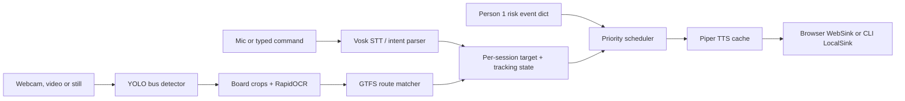
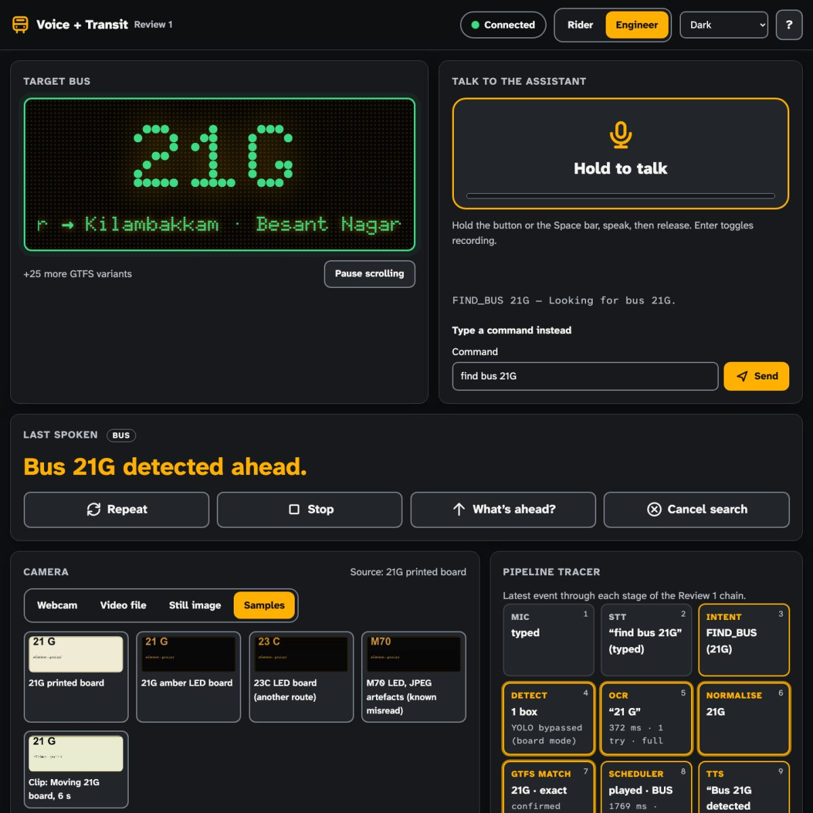
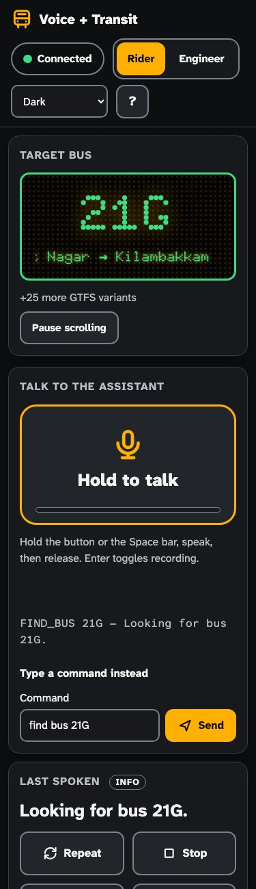
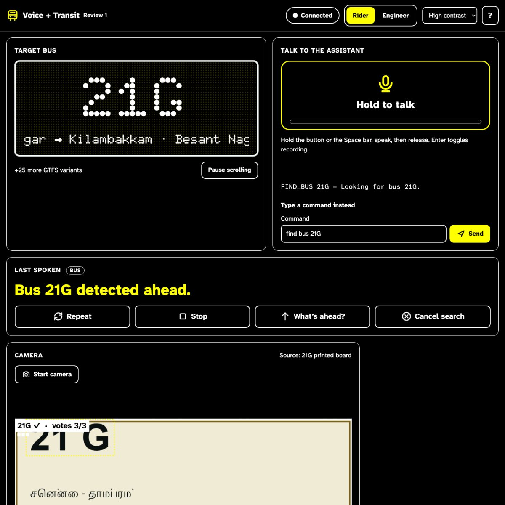
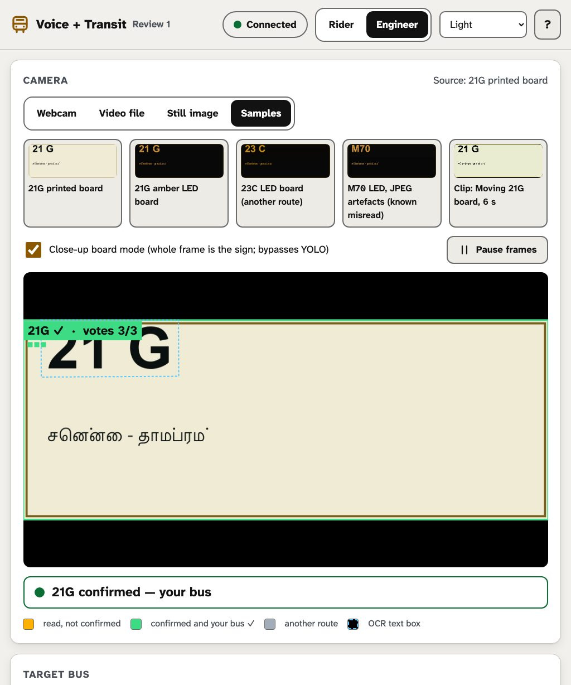

# Offline voice and transit assistant (Review 1)

Python 3.10+. This project listens for a requested bus route, reads route boards
from camera frames, and announces a matching bus. Person 1's risk events can
interrupt bus information with urgent warnings. Models run locally after setup.
The browser page is a debug console.



## Setup and run

```sh
python3 -m venv .venv
.venv/bin/python -m pip install -r requirements.txt
.venv/bin/python scripts/download_models.py
.venv/bin/python -m transit.gtfs_loader
.venv/bin/python -m app.server
# In a second terminal:
.venv/bin/python -m cli.demo --image data/test_images/synthetic/000_21G_printed.jpg --detector passthrough --command "find bus 21G" --null-audio
.venv/bin/python -m cli.mock_risk --null
.venv/bin/python -m bench.benchmark --device-label laptop
.venv/bin/python -m pytest -q
```

Open [http://localhost:8000](http://localhost:8000) for the web console.
Keep the venv at a short path. Piper's bundled espeak-ng cannot find its
phoneme data when `<venv>/lib/python3.x/site-packages/piper/espeak-ng-data`
is longer than about 160 characters, and the process exits during the first
synthesis. From a fresh venv, pytest reports one skip: the optional
Ultralytics backend test.
Use `--device-label pi` on the Raspberry Pi. The benchmark writes
`logs/latency.csv` with device labels in `notes`; it replaces that file on
each run, so save each device's CSV before running the next benchmark.
Use `.venv/bin/python -m cli.mock_risk` for audible local output.

### Risk integration contract

Person 1 sends a plain dictionary to `Assistant.handle_risk` or
`AudioScheduler.submit`:

```python
{"type": "risk", "object": "car", "direction": "right",
 "risk": "HIGH", "timestamp": time.time(),
 "distance_m": 3.2, "ttc_s": 1.4}
```

`type`, `object`, `direction`, `risk`, and `timestamp` are required.
`risk` is LOW, MEDIUM, HIGH, or CRITICAL. Directions supported by speech are
left, right, ahead/front, and behind/back. `distance_m` and `ttc_s` are
optional; extra keys are ignored. Timestamp is wall-clock seconds by default.
For monotonic camera timestamps, configure the scheduler's `event_clock`
accordingly. HIGH and CRITICAL interrupt lower-priority speech.

### Backends

`core/config.py` holds `SpeechConfig` and `PipelineConfig` defaults. Change
`tts_backend` from `piper` to `pyttsx3`, or change the Piper/Vosk model paths
there. `create_ocr_backend("rapidocr" | "tesseract" | "paddleocr")` selects
OCR; the CLI exposes `--ocr`. `BusDetector("auto" | "onnx" | "ultralytics" |
"passthrough")` selects detection; the CLI exposes `--detector`. The web
server constructs defaults in `app/server.py`; its close-up board toggle
uses passthrough explicitly. All model paths must exist locally.

**Data credit:** ChennaiGTFS by Ithu Ungal Soththu is community-maintained
and is not official MTC data.

### Measurement protocol

`python -m bench.benchmark --device-label laptop` writes one row per test to
`logs/latency.csv` with columns `component,backend,test_case,latency_ms,
success,notes,timestamp`. The device label is included in JSON `notes`.
STT latency is the buffered finalization after the last 100 ms PCM chunk;
the audio feed is processed without real-time pacing. Command accuracy
compares parsed intent and route, not word error rate. Piper WAVs in
`data/test_audio/` use their filename as expected command. Real WAVs go in
`data/test_audio/real/` with an optional `labels.csv` containing
`filename,command`; unlabelled clips get latency but no accuracy score.
Real images need `data/test_images/real/labels.csv` rows with at least
`filename,route`. OCR pipeline rows classify exact, fuzzy-correct, wrong, or
none; separate variant rows measure each top/full crop and preprocessing
variant with the same outcome classes. Synthetic close-up boards exercise OCR
without bus detection.
Detector timing uses 30 frames of the synthetic test video, so detection
accuracy on real buses is not established. Scheduler spam uses a NullSink
and counts actual played/cooldown-suppressed decisions at 30 submissions per
second for five seconds. The LocalSink event-to-start metric ends at the
software `play()` call; device buffer and acoustic delay are reported
separately or remain unmeasured.

### Chennai footage and software low-power profile

Label real stills as described in [data/test_images/real/README.md](data/test_images/real/README.md).
The benchmark uses an annotated bus bbox when present, or the highest-confidence
YOLO bus detection otherwise. It prints a route-confusion report for each
`failure_type` tag. The empty real directory is reported as N/A.

```sh
# Optional smaller-input / lower-rate assets:
.venv/bin/python -m pip install ultralytics onnx
.venv/bin/python scripts/download_models.py --only yolo_low piper_low
.venv/bin/python -m cli.demo --video data/test_video.mp4 --low-power --null-audio --command "find bus 21G"
.venv/bin/python -m app.server --low-power
.venv/bin/python -m bench.benchmark --device-label laptop --low-power --output logs/latency_laptop_low_power.csv
```

`--low-power` uses a fixed 320×320 YOLO ONNX export, OCR every fifth
observation per track at a 5 fps cap, and the 16 kHz Piper lessac-low voice.
The standard export is 640×640 and remains the default. The low voice is a
lower-rate [official Piper voice](https://huggingface.co/rhasspy/piper-voices/tree/main/en/en_US/lessac/low);
measure it rather than assuming it is faster. [ONNX Runtime's CPU package
supports Linux ARM64](https://onnxruntime.ai/docs/get-started/with-python.html),
but laptop numbers are not Raspberry Pi 4/5 measurements. On a 64-bit Pi,
install the same requirements, provision these assets, run the benchmark with
`--device-label pi`, and compare the saved CSVs. This environment has no Pi.

`--approaching-only` is also available in the CLI and web server. It
announces a confirmed target route only after three tracked boxes increase
in relative area with at least 12% total growth. This is a heuristic based
on detector boxes, not a speed or distance estimate. A stationary board
close-up will intentionally stay silent when the flag is on.

Laptop software comparison on 2026-10-02, using 30 synthetic-video frames:
640px detector p50 **29.3 ms** versus 320px p50 **8.5 ms**.
Piper medium/low model load was **719.5/716.9 ms**, first synthesis
**117.7/116.6 ms**, and both ONNX files were **63,201,294 bytes**. Thus the
low voice reduces output sample rate but did not materially reduce model
size or synthesis latency here. Results are in
`logs/latency_laptop_default.csv` and
`logs/latency_laptop_low_power.csv`. Neither file is a Pi profile.

### Optional Tamil OCR

`create_ocr_backend("paddleocr")` keeps the same `OCRBackend.read(image)`
interface and returns `OCRLine` values for Tamil/Latin destination text.
The adapter selects PaddleOCR `lang="ta"` and `PP-OCRv5`, which
[officially lists Tamil](https://www.paddleocr.ai/main/en/version3.x/pipeline_usage/OCR.html).
It requires `paddleocr` plus **local** detection and Tamil recognition model
directories under `models/paddleocr/det` and `models/paddleocr/rec`, each
with `inference.yml` and `*.pdiparams`. Runtime refuses missing files rather
than downloading models. The default RapidOCR route reader is unchanged;
Tamil destination recognition does not transliterate Tamil-only route tokens
into the GTFS route catalogue. The optional adapter is covered by a simulated
engine test; actual Paddle inference and Tamil accuracy need provisioned
weights and labelled Tamil footage.

For YOLO ONNX export, install optional `ultralytics onnx` inside the venv and rerun
`scripts/download_models.py --only yolo`. Export uses fixed 640px input and opset 17.
The PT weights remain available for the optional Ultralytics backend.

Downloads use temporary files, minimum sizes, Content-Length checks when supplied,
and SHA256 receipts for subsequent cache checks. Failed tasks report separately
and make the command exit nonzero. Use `--only vosk piper yolo rapidocr gtfs` to
select tasks. To refresh the weekly GTFS feed, delete `data/mtc-gtfs.zip` and rerun
the GTFS download and loader. Only `routes.txt` is opened by the loader.

`load_routes()` prefers `data/routes.csv`; if absent it uses the 20-route
`data/routes_review1.csv`. Out-of-shape bases remain exact-only aliases. Raw short
names and up to three long names are retained per base in the generated CSV.

`normalize_route()` preserves already-valid shapes: without a catalogue, `M7O`
could be either a literal route or an OCR error. `match_route()` tries exact,
unique contextual confusion corrections, then RapidFuzz (default threshold 85).
Fuzzy matching never changes the digit block; tied results are rejected.
`extract_route_candidates()` accepts strings, `{text, box}` dictionaries and
RapidOCR `[box, text, confidence]` rows, returning ranked unique route strings.

RapidOCR is explicitly configured for PP-OCRv4 mobile models using ONNX Runtime
([upstream configuration](https://raw.githubusercontent.com/RapidAI/RapidOCR/main/python/rapidocr/config.yaml)).
The setup script warms it once and writes a complete local-path configuration to
`models/rapidocr/runtime_config.yaml`. The runtime adapter loads that file
with `RapidOCR(config_path=...)` and uses local arrays. The PP-OCR models
are Chinese/Latin models, not Tamil recognition models; Latin route tokens are
the focus for Review 1.

`core/config.py` sets `ORT_DISABLE_TELEMETRY=1` before ONNX Runtime loads.
Without it, onnxruntime 1.30 on macOS starts a telemetry uploader that
occasionally aborted Python at exit.

Models and ZIPs are ignored by Git. Copy the entire `models/` directory and the
route CSV when moving to another machine; the runtime OCR adapter rebases saved
model paths to the local config directory. All dependencies belong in `.venv`.

## Speech layer

`SpeechSynthesizer(SpeechConfig())` loads one Piper voice at startup and returns
`(mono_int16_array, sample_rate)`. Set `tts_backend="pyttsx3"` for the OS voice,
or let Piper load failure select it automatically. The fallback uses espeak-ng
if pyttsx3 cannot initialize and espeak is installed. `load_time_ms`,
`last_synthesis_ms`, `cache_hits`, and `cache_misses` expose timings/counters.
Repeated phrases reuse read-only PCM through a bounded LRU (default 128 phrases).
Playback and interrupt scheduling are provided by `AudioScheduler`.

`SpeechRecognizer` uses grammar-constrained Vosk, including command phrases,
number words, letter names, and `[unk]`. Grammar phrases help the Indian-English
model recognize short US Piper prompts. Vosk warns about a few letter-name
spellings absent from its vocabulary; the parser accepts those spellings from
other recognizers as well. Both classes accept injected backends for benchmarks.
There is no model download in either constructor.

```python
from speech.stt import SpeechRecognizer
from speech.intents import parse_intent

recognizer = SpeechRecognizer()
transcript = recognizer.transcribe(pcm_int16_bytes, sr=16000)
intent = parse_intent(transcript)
# Streaming: start(sr), feed(int16_bytes) -> partial, finish() -> Transcript
```

The default streaming rate is 16kHz mono PCM16, little-endian. Resample browser
audio first with `resample_pcm()`. Keep one stream instance per client; the Vosk
model is retained across utterances on an instance. `spoken_route_candidates()`
handles groups such as "five seventy", digit sequences and letter names.
Ambiguous spoken routes are resolved against the CSV; ties produce
`FIND_BUS(target=None)` with `.prompt == "Which bus number?"`. STOP and CANCEL_BUS
remain separate commands. Parsing never uses a cloud service or an LLM.

For microphone capture:

```sh
.venv/bin/python -m speech.stt --mode ptt  # Enter to start, Enter to finish
.venv/bin/python -m speech.stt --mode vad  # RMS detection, 700ms silence endpoint
.venv/bin/python -m pytest -q
.venv/bin/python -m pytest -q -m slow -s
```

The VAD mode retains 200ms of pre-roll and caps an utterance at 15 seconds; PTT
waits for Enter. Audio device/PortAudio support is needed for a physical mic.
On macOS the pyttsx3 driver runs on the main thread and may require execution
outside an OS sandbox; empty audio is treated as an error. Linux/Pi needs the
local espeak-ng voice packages for this fallback.

Round-trip tests synthesize four prompts into `data/test_audio/*.wav`, resample
the WAVs to 16kHz and assert batch and streaming intents with networking blocked.
They skip when local model files/packages are absent and are marked `slow`.
Measurements append to `logs/speech_latency.csv` and `logs/streaming_latency.csv`.
Batch latency starts when the complete recorded utterance is available and
includes all decoding. Streaming latency in the tests measures the final chunk
plus finalization without realtime pacing. For live capture, pass a monotonic
`end_of_speech_at` to `finish()`; VAD does this using its last voiced chunk, so
its metric includes the silence endpoint delay. These synthetic tests are not
a measurement of live microphone recognition accuracy or hardware latency.

## Priority audio and the mock risk demo

```sh
.venv/bin/python -m pytest tests/test_scheduler.py -q -s
.venv/bin/python -m cli.mock_risk         # audible bus -> HIGH car-right interrupt
.venv/bin/python -m cli.mock_risk --null  # same control flow without speakers
```

`core.events.from_dict()` accepts risk, bus, and system event dictionaries and
ignores extra fields. HIGH car-right says "Vehicle approaching right.";
CRITICAL car-ahead says "Stop. Car ahead."; CRITICAL motorcycle-right says
"Motorcycle right!". LOW/MEDIUM are optional awareness messages.

```python
import time
from speech.tts import SpeechSynthesizer
from speech.scheduler import AudioScheduler, SchedulerConfig

tts = SpeechSynthesizer()
with AudioScheduler(tts, config=SchedulerConfig()) as scheduler:
    scheduler.submit({"type": "risk", "object": "car", "direction": "right",
                      "risk": "HIGH", "timestamp": time.time()})
    # scheduler.repeat() replays the last started message at CHAT priority.
    # scheduler.stop() stops current speech and flushes BUS/INFO/CHAT queues.
    scheduler.wait_idle()
```

Priorities are CRITICAL=0, HIGH=1, BUS=2, INFO=3, CHAT=4. HIGH/CRITICAL pre-empt
strictly lower priorities; equal-priority messages retain FIFO order. An
interrupted BUS restarts once if still within its TTL and still relevant. INFO
and CHAT are discarded on interruption. TTL is checked at admission, while
queued/synthesizing, and immediately before starting/resuming playback; it does
not cut off a phrase already being spoken. A `is_relevant(item)` callback can
reject a bus after tracking/target changes.

Cooldowns start at actual playback, keyed by identity (risk object+direction,
bus route). Defaults are CRITICAL 2s, HIGH 4s, BUS 6s, INFO 6s, CHAT 8s.
Risk escalation bypasses cooldown and replaces queued lower-level alerts. Text
dedupe also respects escalation/priority. STOP retains queued HIGH/CRITICAL
alerts, which may play immediately afterward. Explicit REPEAT bypasses cooldown
but waits behind safety messages.

`submit()` only publishes metadata through a short lock; a dedicated worker
owns scheduling and playback. Synthesis runs in separate urgent/normal executor
queues and CSV writes have their own thread. Even cold/slow synthesis cannot
block submission or playback interruption. Cache hits in `SpeechSynthesizer`
also bypass its backend inference lock, so warmed warnings remain available
while a cold bus phrase is being synthesized. New uncached warnings can still
wait on backend synthesis; pre-warm expected warning phrases at startup (the
mock demo does this). An in-flight model call cannot be forcibly killed, but
its result is discarded after STOP, pre-emption or expiry.

`AudioSink` exposes `play(pcm, sr, item_id)`, `stop()` and `is_playing`. `NullSink`
supports fake durations/clocks. `LocalSink` keeps a stream open at the device's
native sample rate, caches resampling, and swaps to silence on stop. It uses
5ms callback blocks; physical interruption also includes the device's reported
output latency. Device close happens only on scheduler shutdown. Tests verify
the stream is reused and the next callback is silent; software timestamps do
not measure acoustic output. The browser WebSink implements the same interface.

Queue clocks use monotonic time. Integration event timestamps use wall time by
default. Pass `event_clock=time.monotonic` for monotonic CV timestamps, or a
video-position clock for recorded-video timestamps; preserve the original
capture timestamp so stale buffered detections expire correctly. `AudioItem`
uses monotonic `created_at` directly. Mixing these clock domains drops events
incorrectly and must be avoided by the producer.

Every decision is retained in `scheduler.decisions` (last 10,000 entries) and
asynchronously appended to `logs/scheduler_decisions.csv`. `snapshot()["log"]`
(the web state payload) collapses consecutive identical decision/text rows into
one row with `count`, `first_timestamp` and `last_timestamp`; the CSV keeps
every event. `clear_cooldowns(prefix)` forgets cooldowns by identity prefix. The demo uses `logs/mock_risk.csv`
and prints its own decision sequence. Logging errors remain visible through
`log_error` and `logging_error` without stopping audio; fatal worker errors set
`last_error` and make `wait_idle()` raise. The regression suite covers repeats
at simulated 30fps for five seconds, escalation, TTL before/after synthesis,
relevance, dedupe, capacity, STOP races, concurrent producers, backend failures,
and twenty consecutive pre-emption cycles.

## Bus detection, OCR and the shared assistant

```sh
.venv/bin/python -m bench.make_synthetic_boards --count 24 --seconds 8
.venv/bin/python -m cli.demo --image data/test_images/synthetic/000_21G_printed.jpg --detector passthrough --command "find bus 21G" --save-overlay data/test_images/synthetic/demo_overlay.jpg
.venv/bin/python -m cli.demo --video data/test_video.mp4 --detector passthrough --command "find bus 21G" --mock-risk-at 4 --save-overlay data/test_overlay.mp4 --console-log logs/video_demo.log
# Real bus video: default auto detector prefers local ONNX, then Ultralytics.
.venv/bin/python -m cli.demo --video data/real_bus.mp4 --command "find bus 21G" --show --include-trucks
```

`--null-audio` runs without speakers. `--wav data/test_audio/find_21g.wav`
uses Vosk; `--mic` accepts live speech. `--verbose` announces other valid routes
at INFO priority. Generated and real image labels share these CSV columns:
`filename,route,style,distortions,destination,width,height`; `distortions` is JSON.
The generator renders printed/amber LED boards with seeded blur, motion, glare,
perspective and JPEG artifacts. It uses Tamil destination text when a Tamil font
is available, otherwise English. Put real images and labels in
`data/test_images/real/`.

`BusDetector.detect(frame_bgr)` returns `Detection(bbox, conf, cls, track_id)`;
boxes are `(x1,y1,x2,y2)` in original frame pixels. ONNX preprocessing uses a
640px letterbox and RGB/CHW normalization, reverses padding/scale and applies
NMS. Class 5 is retained; class 7 is optional. IoU tracking preserves identities
and expires missed tracks. `PassthroughBackend` is explicitly selected for board
close-ups; it is not an automatic fallback for failed bus detection. Synthetic
board demos exercise OCR/integration, not real-world detector accuracy.

`OCRBackend.read(image)` returns `OCRLine(text, conf, box)` with quadrilateral
boxes in that input's pixels. RapidOCR loads only provisioned local ONNX models;
load failure can select Tesseract if its binary and `pytesseract` are installed.
Tesseract uses PSM 7/11 with an A–Z/0–9 whitelist. Optional PaddleOCR requires
locally provisioned detection and Tamil recognition model directories.
Neither backend downloads models during runtime. `BoardReader` tries the top
35% before the whole bus crop, with CLAHE/upscale, unsharp, Otsu and inverted
variants, plus perspective correction when a quadrilateral contour is found.
It stops on the first catalogue-valid route and records latency for each attempt;
its attempt/time budget bounds repeated preprocessing calls. In board mode
(`read(frame, bbox, board=True)`, used automatically with the passthrough
detector) the whole frame is the sign, so only the full crop is tried. On the
synthetic close-ups this is slower than trying the top crop first; see
`KNOWN_FAILURES.md`.

`Assistant` is the shared CLI/web orchestrator. `handle_transcript`,
`handle_frame` and `handle_risk` accept plain inputs; `handle_frame` returns the
latest JSON overlay immediately. A worker owns detection/OCR, with one active
frame and one replaceable pending frame. FPS limiting and stale-frame rejection
prevent backlog; OCR runs every third observation per track by default. Slow OCR
never runs on the video/UI caller. Overlays include metrics, track boxes, OCR
attempts, matched/confirmed routes and state. OCR boxes explicitly use
`ocr_box_space="preprocessed_crop"`; each `ocr_lines[]` entry also carries
`box_frame`, the same quadrilateral in original frame pixels (upscale undone,
crop offset added, perspective warp inverted). Bus boxes use frame coordinates.
`status` explains silence: `no_bus_in_view`, `reading_board`,
`route_unreadable`, `route_not_in_gtfs` or `confirmed`; `status_text` holds
the best raw OCR text for the two failure states. `handle_frame()` keeps its
submission `status` (`queued`, `skipped_fps`, …) and reports the last
processed frame's value as `overlay_status`.
Use `wait_for_frame()` only for still-image demos or tests.

Tracks confirm with 2 of the last 3 OCR reads, or immediately for exact matches
with confidence >0.9. A target match queues a directional BUS announcement;
other routes stay quiet by default. With no target, WHATS_AHEAD reports recent
confirmed routes. Every FIND_BUS with a route, and every CANCEL_BUS, clears
the scheduler's `bus:` cooldowns and the previous target's votes and
confirmations, so a new search is announced immediately; until the board is
read again, WHATS_AHEAD then reports no confirmed buses.
BUS relevance is checked again before playback against the
current target, visibility and recency. Risk dictionaries feed the independent
priority scheduler. The CLI warms warning phrases and silently prepares the
speaker before accepting events, so cold audio initialization cannot consume
announcement TTLs. `sink_prepare_time_ms` records that startup cost.

Run `.venv/bin/python -m pytest -q` for the complete suite. Model-dependent slow
tests skip when local models are absent. Tests cover decoding/NMS, tracking,
ROI fallback, temporal voting, directional speech, risk integration, OCR cadence,
nonblocking frame submission, stale frames and offline ONNX inference.

## Local browser debug console

```sh
.venv/bin/python -m app.server
# http://localhost:8000 (use --port 8001 if occupied)
.venv/bin/python tests/test_ws_flow.py --url ws://localhost:8000/ws
```

Startup loads routes, Vosk, Piper, RapidOCR and YOLO once and prints wall-clock
load times. Every connection gets independent Vosk decoding, IoU tracking,
target state and a Python priority scheduler, sharing the loaded model weights.
The browser receives PCM encoded as WAV; `WebSink` waits for matching
`playback_done` or WAV duration + 750ms grace. HIGH/CRITICAL pre-emption sends
`stop_audio` and marks the next `speak` as interrupted. Disconnect shuts down
that session's workers and speech queue. No browser speech/cloud API is used.

Press **Start assistant** (browsers allow audio only after a gesture); it
connects the WebSocket and plays a pre-rendered Piper “Ready.” clip. The top
bar shows the connection (Connected / Reconnecting… with backoff / Offline
with a Retry toast), the **Rider / Engineer** mode switch (key M) and the
Dark / Light / High-contrast theme, remembered in `localStorage`. Press `?`
for the shortcut list: Space talk, R repeat, S stop, A ahead, C cancel, H high
contrast, 1/2/3 mock MEDIUM/HIGH/CRITICAL risk, P pause frames.

Rider mode is what a user sees: the dot-matrix target-bus board with GTFS
destinations (static when reduced motion is requested), the push-to-talk
button with a level meter and live partial transcript, a large “Last spoken”
caption, Repeat / Stop / What’s ahead? / Cancel buttons, and a full-width risk
banner with a direction arrow and screen-edge glow that clears when the
warning finishes. Engineer mode adds the 16:9 camera stage (route chips,
`box_frame` OCR boxes, vote meters, an `overlay.status` strip), a source
picker with bundled samples, the pipeline tracer (Mic → STT → Intent → Detect
→ OCR → Normalise → GTFS match → Scheduler → TTS), a 30 s speech timeline,
the risk pad, latency cards against editable budgets, the System card from
`/api/health`, an OCR inspector and an event log with a raw WebSocket view.

The AudioWorklet averages native-rate audio into 16kHz mono PCM16 packets;
release flushes pending PCM before `audio_end`, and recordings stop at 30s.
Use **Close-up board mode** for route-board photos; otherwise YOLO detects bus
boxes. Frames are JPEG quality 0.7, at most 1280px wide, up to 5fps, one at a
time until `frame_ack`. STT latency is audio-end receipt to final transcript
on the server; the TTS card shows scheduler event-to-audio-start (`age_ms` of
`played` rows) with synthesis time beneath it.

The UI is vanilla ES modules under `app/static/js/` with plain CSS, no build
step and no network fetches. Fonts are OFL Atkinson Hyperlegible Next/Mono
and Doto, self-hosted in `app/static/fonts/` with their licences.
`python scripts/prepare_web_assets.py` (network needed once) re-downloads and
subsets the fonts, rebuilds `app/static/samples/` and renders
`app/static/audio/ready.wav` with the local Piper voice. The server sends
`Cache-Control: no-cache` for `/` and `/static/` so a browser never mixes
module versions after an update.

### UI screenshots and browser tests



| Rider, 375 px, dark | Rider, 1440 px, high contrast | Engineer, 1024 px, light |
| --- | --- | --- |
|  |  |  |

All 18 combinations (3 widths × 2 modes × 3 themes) are in
[docs/ui/screenshot-grid.jpg](docs/ui/screenshot-grid.jpg); the test run
regenerates full-page PNGs in `logs/ui/`.

```sh
.venv/bin/python -m pip install -r requirements-dev.txt
.venv/bin/python -m playwright install chromium   # once, needs network
.venv/bin/python scripts/fetch_axe.py              # once: vendors axe-core 4.13.0 into tests/ui/vendor/
.venv/bin/python -m pytest tests/ui -v             # about 45 s
UI_RECORD_DEMO=1 .venv/bin/python -m pytest tests/ui -k record_demo   # writes logs/ui/demo.webm
```

`tests/ui` starts the real server (real models) on a free port and drives
Chromium. Chromium's fake media devices play a padded copy of
`data/test_audio/find_bus_twenty_one_g.wav` as the microphone, so
Space-to-talk exercises the real AudioWorklet, WebSocket and Vosk path. The
tests check: no horizontal scroll at 1440/1024/375 px in both modes and all
themes; typed command plus a 21G sample lights all nine tracer stages and
reaches `confirmed`; HIGH car-right pre-empts a playing bus message, shows the
right-pointing banner and the bus replays; the 30 fps spam shows a `×N
suppressed` badge with N > 50 and at most two spoken bars; a keyboard-only
Tab walk reaches every control with a visible focus ring, and every
shortcut works; axe-core (vendored, never loaded from a CDN) reports no
serious or critical WCAG 2.x A/AA violations in any theme. The UI tests skip
when Playwright or Chromium is not installed.

`GET /api/routes?q=21`, `GET /api/metrics`, and `POST /api/image` are available.
`GET /api/route/21G` returns `{route, variants, long_names}` with every unique
"A TO B" long name from the GTFS feed; the state message's `target_bus` also
carries `long_names`. `GET /api/health` reports each model's file and backend,
any fallback reason, load times, the route count and the git commit (set
`GIT_COMMIT` in Docker, where `.git` is excluded).
The image endpoint accepts multipart `file`, optional `command`, and explicit
`board=true` for close-ups; it returns `overlay` and `annotated_jpeg_b64`. It
uses the same Assistant pipeline with a silent sink. Frames/images are limited
to 4 MiB compressed and 8 megapixels decoded.

WebSocket controls use JSON `type`: `text_command`, `audio_start`, `audio_end`,
`mock_risk`, `playback_done` and `source_mode` (`mode: bus|board`). After
`audio_start`, untagged binary messages are 16kHz mono little-endian PCM16.
For JPEG binary messages send `{"type":"frame","id":1}` immediately before
that binary message. Alternatively include `jpeg_b64` in the frame JSON.
Responses include `ready`, `partial_transcript`, `transcript`, `intent`, `state`,
`overlay`, `frame_ack`, `speak`, `stop_audio`, `metrics` and recoverable `error`.
Risk controls carry the integration contract's object/direction/risk fields;
the mock server assigns the current wall-clock timestamp.

Mic/webcam and AudioWorklet require a secure context: localhost works over HTTP;
a phone accessing a LAN IP needs HTTPS. Browser capture always requires the
reviewer's permission. See [MDN getUserMedia](https://developer.mozilla.org/en-US/docs/Web/API/MediaDevices/getUserMedia)
and [MDN AudioWorklet](https://developer.mozilla.org/en-US/docs/Web/API/AudioWorklet).

```sh
.venv/bin/python -m app.server --host 0.0.0.0 --https --cert-host 192.168.1.20
# https://192.168.1.20:8000 on the phone; substitute the laptop's LAN IP.
```

The HTTPS flag generates a 30-day self-signed certificate using OpenSSL under
`models/tls/` if absent. Install/trust that certificate on the test phone; simply
bypassing a certificate warning may not enable capture in every browser. To
change the LAN IP, regenerate or supply `--cert` and `--key`. This is a debug
server with no login: bind only on the intended test network.

```sh
docker build -t ifsp-review1 .
docker run --rm -p 8000:8000 ifsp-review1
# Hugging Face Docker Spaces / a VM using port 7860:
docker run --rm -e PORT=7860 -p 7860:7860 ifsp-review1
```

The slim Python image uses a venv, espeak-ng, Tesseract, OpenCV libraries and
local model downloads/export during **build**. The resulting container needs no
runtime internet or host audio device. Docker ignores local models, venv and
logs. For Docker Spaces set its app port to 7860 and provide this Dockerfile;
Python reads `PORT` (default 8000). Model/API adapters remain independent of
FastAPI; the UI uses vanilla JS and static assets, with no build step or CDN.
The server uses [FastAPI WebSockets](https://fastapi.tiangolo.com/advanced/websockets/).
